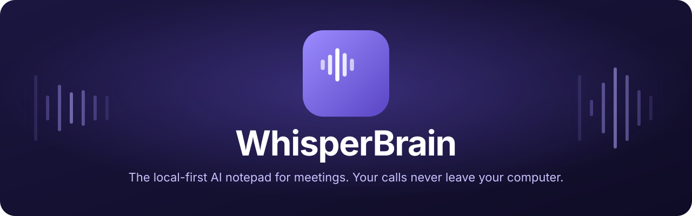
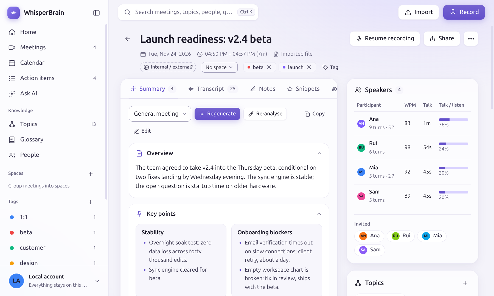
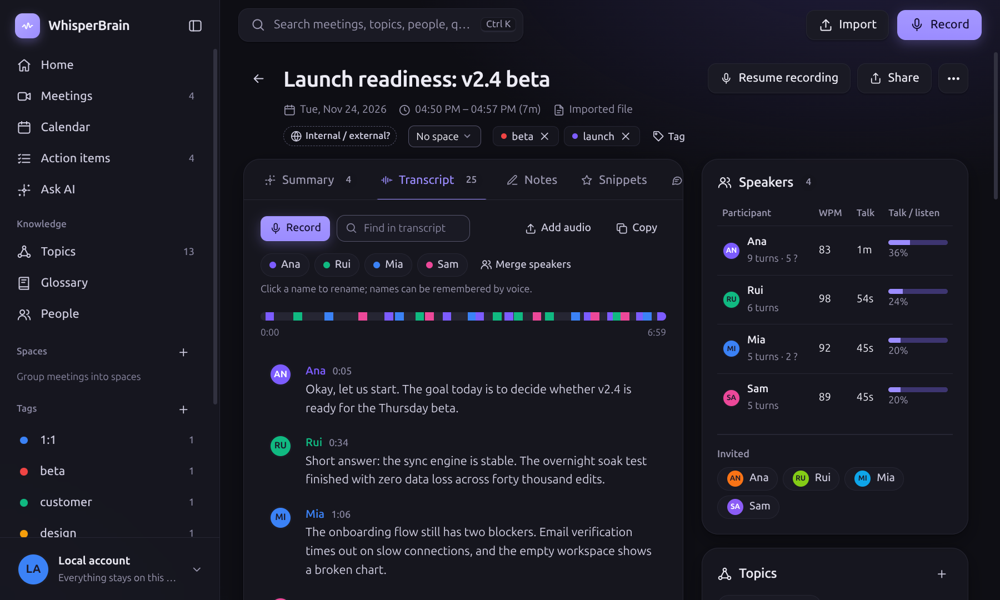
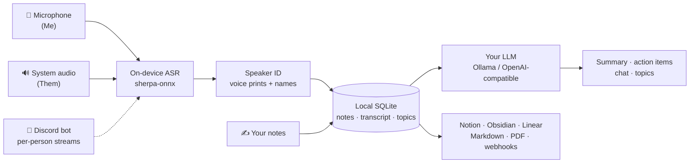

<div align="center">



<br>

[](https://github.com/nevespvasco/WhisperBrain/actions/workflows/build.yml)


**Type your notes, record the call, get a transcript that says _who_ said what.**<br>
Then enhance the notes and chat with them using any LLM you choose.

[Quick start](#quick-start) · [Features](#features) · [How it works](#how-it-works) · [Privacy](#privacy) · [Docs](#documentation) · [Development](#development)

</div>

<br>

WhisperBrain is a meeting notepad that keeps everything on your computer. Audio is transcribed on-device with [sherpa-onnx](https://github.com/k2-fsa/sherpa-onnx), notes live in a local SQLite file, and the only text that ever leaves the machine goes to the LLM server **you** configure (Ollama, LM Studio, OpenRouter, or any OpenAI-compatible endpoint).

<div align="center">





</div>

## Highlights

<table>
<tr>
<td width="33%" valign="top">

### 🎙️ Records both sides
Microphone (**Me**) and system audio (**Them**) as separate channels, with live transcript, levels, pause/resume and echo removal.

</td>
<td width="33%" valign="top">

### 🗣️ Knows who spoke
Voice prints, live clustering, one-click naming, voices remembered across meetings, and names read from the Meet or Discord call itself.

</td>
<td width="33%" valign="top">

### ✨ Your notes, enhanced
Templates turn your own notes plus the transcript into an overview, key points, decisions and action items with owners and dates.

</td>
</tr>
<tr>
<td valign="top">

### 🕸️ Connects meetings
Topics, a glossary and a people directory link your meetings together, with an interactive topic map and who-said-what search.

</td>
<td valign="top">

### 🔒 Private by design
Audio is never stored, the server only listens on `127.0.0.1`, and there is no cloud service to sign up for. Bring your own model, or run one locally.

</td>
<td valign="top">

### 🔌 Fits your tools
Google Calendar, Notion, Obsidian, Linear, signed webhooks, and import or export in every format you are likely to have.

</td>
</tr>
</table>

## Quick start

> Requires **Node.js 24 or newer**. Linux, macOS and Windows are supported; see [platform support](#platform-support).

```bash
git clone https://github.com/nevespvasco/WhisperBrain.git
cd WhisperBrain
npm install
npm start
```

On first launch WhisperBrain opens a **Set up WhisperBrain** check that lists what this computer is missing, with the command or the setting that fixes each item (Settings → Setup check opens it again). What it looks for:

| | Linux | macOS | Windows |
|---|---|---|---|
| **Needed to record** | PipeWire (`pw-record`, `pw-dump`) | macOS 13+, Microphone permission | Microphone access for desktop apps |
| **Recommended** | | Screen & System Audio Recording permission | |
| **Optional** | `xclip` or `wl-clipboard` + `wtype` (dictation paste), `x11-utils` + `wmctrl` (window titles) | Accessibility permission (paste, names from the meeting window) | |
| **All systems** | a speech model (downloaded in the app), `ffmpeg` to import files other than WAV | | |

Then:

1. **Settings → Audio & transcription**: download a speech model. The 26 MB voice model for speaker recognition comes with it.
2. **Settings → AI**: point it at an LLM server. With [Ollama](https://ollama.com) the defaults work: run `ollama pull llama3.2`, then pick that model.

<details>
<summary><b>Run headless, in a browser</b></summary>

```bash
node src/server/cli.js --port 3787
```

Prints a one-time login URL for `http://127.0.0.1:3787`.

</details>

<details>
<summary><b>Build an installer</b></summary>

```bash
npm run dist:linux   # AppImage + .deb   (on Linux)
npm run dist:mac     # .dmg + .zip       (on macOS)
npm run dist:win     # NSIS + portable   (on Windows)
```

Each OS must build its own installer, because npm only installs the sherpa-onnx native package for the current platform. [`.github/workflows/build.yml`](.github/workflows/build.yml) builds all three in CI. Builds are unsigned until signing secrets are added; see [docs/packaging.md](docs/packaging.md).

</details>

## How it works



## Features

<details open>
<summary><b>Capture and speakers</b></summary>

| | |
|---|---|
| **Record** | Mic ("Me") and system audio ("Them") as separate channels, live transcript, levels, pause/resume, echo removal ([details](docs/echo-cancellation.md)) |
| **Live draft captions** | Optional streaming model shows dimmed draft words while people speak, replaced by the final text ([details](docs/live-draft-captions.md)) |
| **Who is talking** | Voice prints per utterance, live clustering into *Speaker 1, 2…*, one-click naming with attendee suggestions, "remember this voice" across meetings, per-line reassignment |
| **Names from the call** | On a Google Meet call, reads who is on the call and who is speaking from the meeting window (the browser's accessibility tree, or a small browser extension, with a local vision model as a last resort). Puts the right name on each voice, uses the people on the call as the number of voices, joins and splits voices where the names say so, and remembers voices named beyond doubt. See [docs/meeting-names.md](docs/meeting-names.md) |
| **Speaker double-check** | When you press Stop, the recording is analysed again for **pitch and timbre** (MFCC voice colour, brightness) on top of the voice model: misjudged utterances are re-assigned, two people the voice model merged are split, one person it cut in two is rejoined, and pitch is kept so a saved voice is never matched to a clearly different voice. Runs only after capture ends, so live transcription is never slowed down |
| **Discord bot** | A bot in your Discord voice channel hears every person on their own audio stream (a computer only plays one mixed sound), so overlapping speech is kept and each line carries the person's Discord name. Handles Discord's end-to-end encrypted calls (DAVE). Falls back to normal system audio when you are not in a call |
| **Floating recorder** | While recording and WhisperBrain is minimised, hidden or behind another window, a small always-on-top icon (pulsing dot, timer, level) floats in the corner. Click it to read the live transcript with names, pause or stop, or jump back to the note; drag it anywhere |
| **Recognise meetings** | Notices Zoom, Teams, Meet (in a browser tab), Slack, Discord… using the microphone, reads meeting window titles on X11, matches the calendar event by time and meeting link. Then: ask, record automatically, or nothing; auto-stop when the call ends |
| **Dictation** | A global shortcut records, transcribes and pastes into the focused app |

</details>

<details open>
<summary><b>Notes, AI and knowledge</b></summary>

| | |
|---|---|
| **Summary** | Templates enhance your own notes; structured overview, key-point cards, decisions, next steps; editable action items with owners and due dates |
| **Chat** | Per meeting, or across all meetings with retrieval, glossary context and links to sources |
| **Topics** | Extracted per meeting (by your LLM, or offline with keyphrase extraction) and reusing existing names, so meetings connect. Interactive topic map, topic pages with a timeline, who said what, related topics, and an AI synthesis across meetings. Rename / merge / pin / hide |
| **Glossary** | Acronyms and jargon collected automatically (never overwriting your own definitions), underlined in transcripts with their definition, each with every place it was said |
| **People** | Everyone who spoke or was invited: their quotes, meetings, topics, talk time and the action items they own |
| **Speaker analytics** | Talk time, words per minute, turns, questions, talk % / listen %, and a timeline of who spoke when |
| **Meeting assistant** | While a meeting records, notices questions from the other side and drafts a short suggestion from your **briefings** (CV, job description, project notes; PDF, Word, Markdown) and what was said, marking anything your material does not support. Live summary with decisions, action items and open questions, technical term cards, "ask about this call", a question read off your screen, global shortcuts, and the floating window. Off by default, local AI server unless you allow another, visible like any window. See [docs/assistant.md](docs/assistant.md) |
| **Search** | ⌘K palette over meetings, transcript lines (who said what), topics, people, glossary, tags and action items, with filter chips, sort, date range, grouped by day, keyboard-only |

</details>

<details open>
<summary><b>Organise, import, export and integrate</b></summary>

| | |
|---|---|
| **Home** | Start an online meeting (paste the link), an in-person one (microphone only) or upload one; recent meetings; today's calendar with per-meeting "record automatically" switches; open to-dos |
| **Calendar** | Google Calendar (OAuth sign-in, read-only) or any iCal feed / `.ics` file; week view; record all calendar meetings, only selected ones, or just remind |
| **Organise** | Spaces, coloured tags, pinning, bulk select (export, tag, move, delete), internal / external meetings from attendee domains, and a "From outside" view that keeps imported material apart from your own recordings |
| **Import** | Audio and video (transcribed on-device); VTT/SRT (Zoom, Teams, Meet), TXT (Otter-style and others), Markdown with frontmatter, JSON (WhisperBrain, Whisper, AssemblyAI, Deepgram), DOCX, HTML, CSV; pasted text; drag and drop anywhere; Notion pages, Obsidian notes and Linear issues |
| **Export & share** | Markdown, PDF, HTML, plain text, Obsidian Markdown (YAML + `[[links]]`), JSON, SRT, WebVTT; copy as rich text; email; print; bulk ZIP |
| **Integrations** | Notion (pages into a page or database), Obsidian (vault folder, updated in place), Linear (an issue with the summary, or one per action item, with assignee matching), signed webhooks (Zapier, Make, n8n, your server); optional auto-export after enhancing. Setup: [docs/integrations.md](docs/integrations.md) |
| **App** | Light and dark, English and Portuguese, responsive from phone width to wide desktop, collapsible sidebar, keyboard shortcuts. Local account, data overview, backups, saved voices, danger zone |

</details>

## Platform support

Only three things differ per OS; everything else is shared code.

| | Linux | macOS | Windows |
|---|:---:|:---:|:---:|
| Microphone | ✅ PipeWire | ⚠️ `getUserMedia` | ⚠️ `getUserMedia` |
| System audio | ✅ PipeWire monitor | ⚠️ ScreenCaptureKit (macOS 13+) | ⚠️ WASAPI loopback |
| Echo cancellation | ✅ PipeWire AEC3 | ⚠️ Chromium | ⚠️ Chromium |
| Mic-in-use detection | ✅ `pw-dump` | ⚠️ `pmset` heuristic | ⚠️ registry |
| Dictation paste | ✅ X11 · wlroots Wayland | ⚠️ needs Accessibility | ⚠️ `SendKeys` |
| Installer | AppImage, `.deb` | `.dmg`, `.zip` | NSIS, portable |

✅ developed and tested on real hardware (X11, PipeWire). ⚠️ written, with unit-tested parsers and packages assembled from Linux, but **not yet run on a real Mac or Windows machine**. Details in [docs/architecture.md](docs/architecture.md#platform-adapters).

## Privacy

- **Audio is never stored.** It is transcribed in memory.
- While a recording runs, its raw audio is parked in a private temporary file (`<data>/spool`, user-only permissions) so the speaker double-check can listen again after Stop. The file is deleted as soon as that finishes, and leftovers from a crash are removed at the next start. Turn it off with *Settings → Double-check speakers after recording*; nothing is then written.
- **Voice prints** are numeric embeddings in the local database. Only voices you choose to remember become profiles.
- **Reading the meeting window** (the accessibility readers, the browser extension, the optional look at the window) is local and runs only while a recording does. The extension talks to a port of its own on 127.0.0.1 with its own secret and accepts calls from browser extensions only. Only the optional vision source sends a picture, to the LLM you configured.
- **The local server** listens on 127.0.0.1 only, requires a per-launch token and refuses foreign `Host` and `Origin` headers.
- **API keys** are never sent to the UI or included in exports.
- **The meeting assistant** is off by default, uses a local AI server unless you allow another, stays off in a meeting where someone objected, and never hides from screen sharing ([details](docs/assistant.md#privacy)).

## Documentation

| Guide | What it covers |
|---|---|
| [Architecture](docs/architecture.md) | Module layout and per-OS platform adapters |
| [Echo cancellation](docs/echo-cancellation.md) | The two layers, the Linux PipeWire helper, what is untested on macOS and Windows |
| [Live draft captions](docs/live-draft-captions.md) | Streaming drafts, their cost, and how to measure it |
| [Names from the meeting window](docs/meeting-names.md) | How speaker names are read from Meet, and what is verified |
| [Meeting assistant](docs/assistant.md) | Live suggestions, briefings, live summary, shortcuts, privacy, measurements |
| [Integrations](docs/integrations.md) | Google Calendar, Notion, Linear, Discord, Obsidian, webhooks |
| [Packaging](docs/packaging.md) | Signing, notarization, database at rest |
| [Plans](docs/plans.md) | Speaker-ID and translation plans and what was built |
| [Testing](docs/testing.md) | What the 400+ tests cover |

## Development

```bash
npm test                        # 400+ tests, using real models and devices when present
node scripts/fetch-models.js    # fetch the test models into ./.models
```

Tests that need a model or a device skip themselves when it is missing. [docs/testing.md](docs/testing.md) lists what is covered.

## Acknowledgements

WhisperBrain is an independent implementation. It contains no code, text, images or branding from any other meeting-notes product. The speech models are the public [k2-fsa/sherpa-onnx](https://github.com/k2-fsa/sherpa-onnx) releases (NVIDIA Parakeet, OpenAI Whisper, Silero VAD, WeSpeaker), under their own licences.

The two short audio clips in `test/fixtures/` are sample recordings shipped with the public sherpa-onnx model releases (Apache-2.0), resampled to 16 kHz mono.
